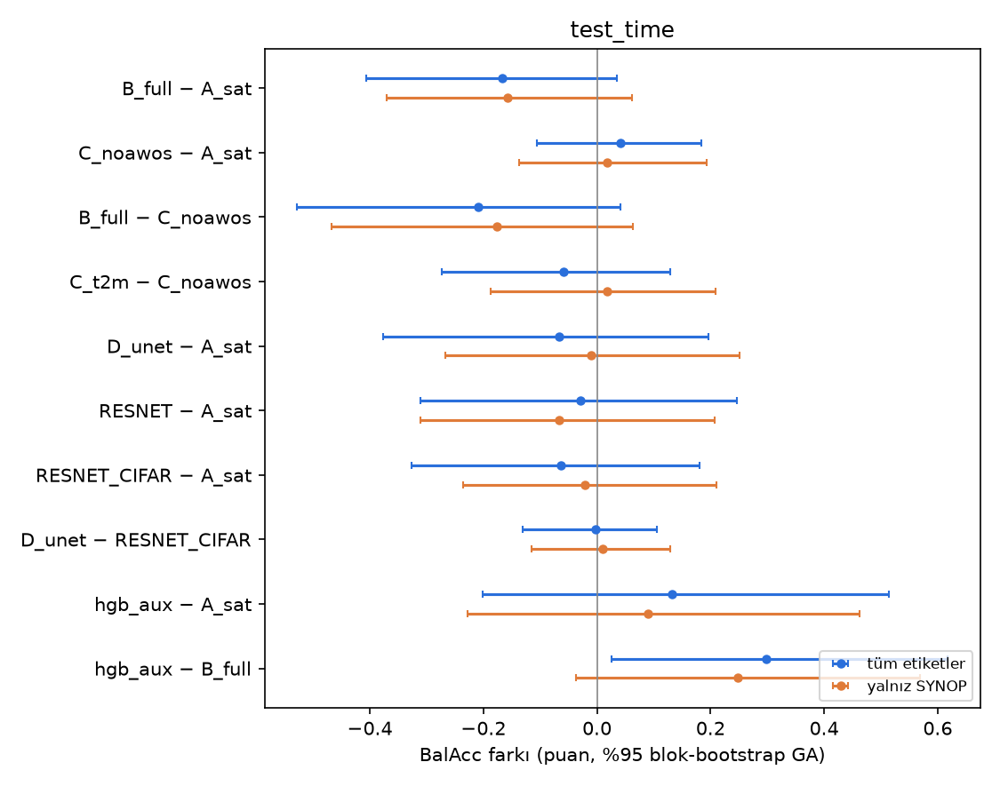
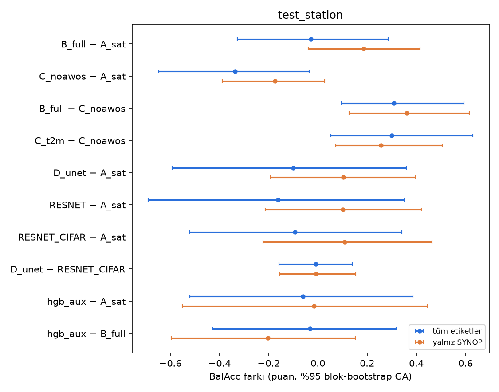
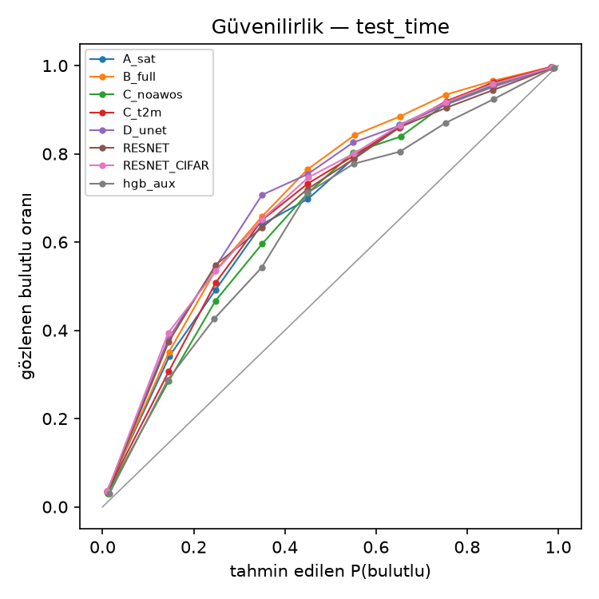

# MTGCLM v3 — örnek bazlı analiz

Üretildi: 2026-10-26 10:58 · kaynak `artifacts_v3` · 44 koşu · bootstrap 2000 tekrar
Cihaz/kod: Tesla T4 @ 4a69c7b; cpu @ b68d201; cpu @ e2ff6d2

Karar eşiği 0,5. GA: %95 blok-bootstrap (test_time/test_both gün, test_station istasyon blokları; seed'ler aynı örneklemde ortalanır). p_bootstrap iki yönlü. McNemar kümelenmeyi yok sayar, yalnız ek bilgi.

## 1. test_time

**Tüm etiketler** (n = 40868)

| Deney | Seed | BalAcc ± s.s. | %95 GA | MCC | Brier | ECE | Son epoch BalAcc |
|---|---|---|---|---|---|---|---|
| A_sat (uydu+radar) | 3 | 0.9580 ± 0.0002 | [0.9467, 0.9671] | 0.8972 | 0.0354 | 0.0408 | 0.9590 |
| B_full (+tüm aux) | 3 | 0.9564 ± 0.0008 | [0.9450, 0.9655] | 0.8916 | 0.0376 | 0.0465 | 0.9577 |
| C_noawos (aux, AWOS'suz) | 3 | 0.9585 ± 0.0017 | [0.9474, 0.9672] | 0.8997 | 0.0341 | 0.0362 | 0.9592 |
| C_t2m (C + t2m) | 3 | 0.9579 ± 0.0009 | [0.9465, 0.9668] | 0.8967 | 0.0354 | 0.0405 | 0.9580 |
| U-Net | 3 | 0.9574 ± 0.0003 | [0.9461, 0.9664] | 0.8953 | 0.0354 | 0.0371 | 0.9577 |
| ResNet18 (ImageNet girişi) | 3 | 0.9578 ± 0.0004 | [0.9464, 0.9670] | 0.8981 | 0.0345 | 0.0341 | 0.9574 |
| ResNet18 (CIFAR girişi) | 3 | 0.9574 ± 0.0011 | [0.9465, 0.9663] | 0.8961 | 0.0359 | 0.0399 | 0.9576 |
| HGB | 1 | 0.9594 | [0.9494, 0.9678] | 0.9046 | 0.0321 | 0.0244 | - |
| Rastgele orman | 1 | 0.9538 | [0.9427, 0.9632] | 0.8939 | 0.0375 | 0.0390 | - |
| Lojistik regresyon | 1 | 0.9481 | [0.9342, 0.9592] | 0.8687 | 0.0460 | 0.0449 | - |

**Yalnız SYNOP etiketleri** (n = 23100)

| Deney | Seed | BalAcc ± s.s. | %95 GA | MCC | Brier | ECE | Son epoch BalAcc |
|---|---|---|---|---|---|---|---|
| A_sat (uydu+radar) | 3 | 0.9550 ± 0.0002 | [0.9416, 0.9654] | 0.9033 | 0.0360 | 0.0292 | 0.9557 |
| B_full (+tüm aux) | 3 | 0.9534 ± 0.0011 | [0.9392, 0.9645] | 0.8989 | 0.0375 | 0.0354 | 0.9547 |
| C_noawos (aux, AWOS'suz) | 3 | 0.9552 ± 0.0018 | [0.9420, 0.9654] | 0.9043 | 0.0352 | 0.0251 | 0.9560 |
| C_t2m (C + t2m) | 3 | 0.9553 ± 0.0007 | [0.9417, 0.9660] | 0.9040 | 0.0358 | 0.0294 | 0.9556 |
| U-Net | 3 | 0.9549 ± 0.0001 | [0.9413, 0.9655] | 0.9028 | 0.0358 | 0.0275 | 0.9550 |
| ResNet18 (ImageNet girişi) | 3 | 0.9543 ± 0.0004 | [0.9401, 0.9652] | 0.9023 | 0.0360 | 0.0257 | 0.9543 |
| ResNet18 (CIFAR girişi) | 3 | 0.9548 ± 0.0016 | [0.9414, 0.9652] | 0.9029 | 0.0364 | 0.0302 | 0.9549 |
| HGB | 1 | 0.9559 | [0.9442, 0.9653] | 0.9063 | 0.0349 | 0.0183 | - |
| Rastgele orman | 1 | 0.9515 | [0.9390, 0.9616] | 0.8991 | 0.0397 | 0.0346 | - |
| Lojistik regresyon | 1 | 0.9444 | [0.9285, 0.9573] | 0.8784 | 0.0464 | 0.0326 | - |

## 1. test_station

**Tüm etiketler** (n = 43865)

| Deney | Seed | BalAcc ± s.s. | %95 GA | MCC | Brier | ECE | Son epoch BalAcc |
|---|---|---|---|---|---|---|---|
| A_sat (uydu+radar) | 3 | 0.9407 ± 0.0005 | [0.9241, 0.9540] | 0.8423 | 0.0425 | 0.0551 | 0.9402 |
| B_full (+tüm aux) | 3 | 0.9404 ± 0.0005 | [0.9249, 0.9541] | 0.8343 | 0.0447 | 0.0595 | 0.9412 |
| C_noawos (aux, AWOS'suz) | 3 | 0.9373 ± 0.0019 | [0.9198, 0.9519] | 0.8353 | 0.0427 | 0.0522 | 0.9386 |
| C_t2m (C + t2m) | 3 | 0.9403 ± 0.0007 | [0.9233, 0.9544] | 0.8424 | 0.0413 | 0.0510 | 0.9401 |
| U-Net | 3 | 0.9397 ± 0.0008 | [0.9210, 0.9553] | 0.8340 | 0.0436 | 0.0476 | 0.9392 |
| ResNet18 (ImageNet girişi) | 3 | 0.9390 ± 0.0010 | [0.9215, 0.9544] | 0.8357 | 0.0426 | 0.0433 | 0.9362 |
| ResNet18 (CIFAR girişi) | 3 | 0.9397 ± 0.0012 | [0.9210, 0.9556] | 0.8361 | 0.0433 | 0.0494 | 0.9377 |
| HGB | 1 | 0.9401 | [0.9248, 0.9542] | 0.8515 | 0.0380 | 0.0319 | - |
| Rastgele orman | 1 | 0.9340 | [0.9166, 0.9503] | 0.8520 | 0.0383 | 0.0405 | - |
| Lojistik regresyon | 1 | 0.9335 | [0.9188, 0.9459] | 0.8122 | 0.0503 | 0.0557 | - |

**Yalnız SYNOP etiketleri** (n = 28238)

| Deney | Seed | BalAcc ± s.s. | %95 GA | MCC | Brier | ECE | Son epoch BalAcc |
|---|---|---|---|---|---|---|---|
| A_sat (uydu+radar) | 3 | 0.9340 ± 0.0007 | [0.9152, 0.9484] | 0.8438 | 0.0476 | 0.0467 | 0.9335 |
| B_full (+tüm aux) | 3 | 0.9358 ± 0.0004 | [0.9188, 0.9495] | 0.8452 | 0.0473 | 0.0483 | 0.9363 |
| C_noawos (aux, AWOS'suz) | 3 | 0.9322 ± 0.0010 | [0.9133, 0.9473] | 0.8428 | 0.0461 | 0.0398 | 0.9332 |
| C_t2m (C + t2m) | 3 | 0.9348 ± 0.0008 | [0.9162, 0.9497] | 0.8479 | 0.0451 | 0.0404 | 0.9346 |
| U-Net | 3 | 0.9350 ± 0.0012 | [0.9162, 0.9500] | 0.8450 | 0.0464 | 0.0380 | 0.9341 |
| ResNet18 (ImageNet girişi) | 3 | 0.9350 ± 0.0013 | [0.9171, 0.9497] | 0.8475 | 0.0452 | 0.0338 | 0.9321 |
| ResNet18 (CIFAR girişi) | 3 | 0.9351 ± 0.0015 | [0.9149, 0.9505] | 0.8470 | 0.0459 | 0.0380 | 0.9325 |
| HGB | 1 | 0.9338 | [0.9179, 0.9478] | 0.8539 | 0.0430 | 0.0252 | - |
| Rastgele orman | 1 | 0.9289 | [0.9087, 0.9458] | 0.8542 | 0.0425 | 0.0263 | - |
| Lojistik regresyon | 1 | 0.9280 | [0.9120, 0.9408] | 0.8235 | 0.0542 | 0.0443 | - |

## 1. test_both

**Tüm etiketler** (n = 10215)

| Deney | Seed | BalAcc ± s.s. | %95 GA | MCC | Brier | ECE | Son epoch BalAcc |
|---|---|---|---|---|---|---|---|
| A_sat (uydu+radar) | 3 | 0.9536 ± 0.0007 | [0.9415, 0.9633] | 0.8932 | 0.0378 | 0.0375 | 0.9547 |
| B_full (+tüm aux) | 3 | 0.9501 ± 0.0011 | [0.9368, 0.9603] | 0.8832 | 0.0419 | 0.0448 | 0.9510 |
| C_noawos (aux, AWOS'suz) | 3 | 0.9519 ± 0.0024 | [0.9398, 0.9616] | 0.8908 | 0.0383 | 0.0359 | 0.9534 |
| C_t2m (C + t2m) | 3 | 0.9526 ± 0.0014 | [0.9409, 0.9618] | 0.8901 | 0.0388 | 0.0390 | 0.9522 |
| U-Net | 3 | 0.9495 ± 0.0013 | [0.9370, 0.9595] | 0.8820 | 0.0412 | 0.0382 | 0.9484 |
| ResNet18 (ImageNet girişi) | 3 | 0.9486 ± 0.0021 | [0.9361, 0.9583] | 0.8791 | 0.0419 | 0.0397 | 0.9478 |
| ResNet18 (CIFAR girişi) | 3 | 0.9485 ± 0.0018 | [0.9353, 0.9590] | 0.8800 | 0.0422 | 0.0417 | 0.9486 |
| HGB | 1 | 0.9491 | [0.9351, 0.9606] | 0.8854 | 0.0395 | 0.0246 | - |
| Rastgele orman | 1 | 0.9470 | [0.9325, 0.9594] | 0.8836 | 0.0436 | 0.0378 | - |
| Lojistik regresyon | 1 | 0.9411 | [0.9254, 0.9536] | 0.8616 | 0.0499 | 0.0374 | - |

**Yalnız SYNOP etiketleri** (n = 6628)

| Deney | Seed | BalAcc ± s.s. | %95 GA | MCC | Brier | ECE | Son epoch BalAcc |
|---|---|---|---|---|---|---|---|
| A_sat (uydu+radar) | 3 | 0.9484 ± 0.0005 | [0.9336, 0.9593] | 0.8928 | 0.0406 | 0.0265 | 0.9494 |
| B_full (+tüm aux) | 3 | 0.9465 ± 0.0010 | [0.9316, 0.9576] | 0.8883 | 0.0420 | 0.0296 | 0.9475 |
| C_noawos (aux, AWOS'suz) | 3 | 0.9487 ± 0.0015 | [0.9339, 0.9598] | 0.8943 | 0.0395 | 0.0202 | 0.9492 |
| C_t2m (C + t2m) | 3 | 0.9482 ± 0.0006 | [0.9338, 0.9591] | 0.8925 | 0.0407 | 0.0251 | 0.9488 |
| U-Net | 3 | 0.9470 ± 0.0005 | [0.9327, 0.9582] | 0.8899 | 0.0410 | 0.0242 | 0.9468 |
| ResNet18 (ImageNet girişi) | 3 | 0.9473 ± 0.0018 | [0.9330, 0.9580] | 0.8903 | 0.0407 | 0.0240 | 0.9471 |
| ResNet18 (CIFAR girişi) | 3 | 0.9468 ± 0.0014 | [0.9320, 0.9581] | 0.8895 | 0.0415 | 0.0255 | 0.9473 |
| HGB | 1 | 0.9465 | [0.9299, 0.9591] | 0.8902 | 0.0421 | 0.0170 | - |
| Rastgele orman | 1 | 0.9450 | [0.9296, 0.9576] | 0.8884 | 0.0453 | 0.0252 | - |
| Lojistik regresyon | 1 | 0.9375 | [0.9203, 0.9507] | 0.8689 | 0.0514 | 0.0273 | - |

## 2. Eşleştirilmiş karşılaştırmalar (fark = ilk − ikinci, BalAcc)

| Küme | Etiket | Çift | Fark [%95 GA] | p (bootstrap) | GA sıfırı dışlıyor | Blok |
|---|---|---|---|---|---|---|
| test_time | tümü | B_full − A_sat | -0.0017 [-0.0041, +0.0003] | 0.108 |  | 31 |
| test_time | tümü | C_noawos − A_sat | +0.0004 [-0.0011, +0.0018] | 0.550 |  | 31 |
| test_time | tümü | B_full − C_noawos | -0.0021 [-0.0053, +0.0004] | 0.118 |  | 31 |
| test_time | tümü | C_t2m − C_noawos | -0.0006 [-0.0027, +0.0013] | 0.594 |  | 31 |
| test_time | tümü | D_unet − A_sat | -0.0007 [-0.0038, +0.0020] | 0.648 |  | 31 |
| test_time | tümü | RESNET − A_sat | -0.0003 [-0.0031, +0.0025] | 0.807 |  | 31 |
| test_time | tümü | RESNET_CIFAR − A_sat | -0.0006 [-0.0033, +0.0018] | 0.592 |  | 31 |
| test_time | tümü | D_unet − RESNET_CIFAR | -0.0000 [-0.0013, +0.0011] | 0.977 |  | 31 |
| test_time | tümü | hgb_aux − A_sat | +0.0013 [-0.0020, +0.0051] | 0.457 |  | 31 |
| test_time | tümü | hgb_aux − B_full | +0.0030 [+0.0003, +0.0062] | 0.036 | evet | 31 |
| test_time | SYNOP | B_full − A_sat | -0.0016 [-0.0037, +0.0006] | 0.145 |  | 31 |
| test_time | SYNOP | C_noawos − A_sat | +0.0002 [-0.0014, +0.0019] | 0.833 |  | 31 |
| test_time | SYNOP | B_full − C_noawos | -0.0018 [-0.0047, +0.0006] | 0.176 |  | 31 |
| test_time | SYNOP | C_t2m − C_noawos | +0.0002 [-0.0019, +0.0021] | 0.838 |  | 31 |
| test_time | SYNOP | D_unet − A_sat | -0.0001 [-0.0027, +0.0025] | 0.888 |  | 31 |
| test_time | SYNOP | RESNET − A_sat | -0.0007 [-0.0031, +0.0021] | 0.587 |  | 31 |
| test_time | SYNOP | RESNET_CIFAR − A_sat | -0.0002 [-0.0024, +0.0021] | 0.831 |  | 31 |
| test_time | SYNOP | D_unet − RESNET_CIFAR | +0.0001 [-0.0011, +0.0013] | 0.902 |  | 31 |
| test_time | SYNOP | hgb_aux − A_sat | +0.0009 [-0.0023, +0.0046] | 0.596 |  | 31 |
| test_time | SYNOP | hgb_aux − B_full | +0.0025 [-0.0004, +0.0057] | 0.085 |  | 31 |
| test_station | tümü | B_full − A_sat | -0.0003 [-0.0033, +0.0029] | 0.962 |  | 30 |
| test_station | tümü | C_noawos − A_sat | -0.0034 [-0.0065, -0.0004] | 0.022 | evet | 30 |
| test_station | tümü | B_full − C_noawos | +0.0031 [+0.0010, +0.0059] | 0.001 | evet | 30 |
| test_station | tümü | C_t2m − C_noawos | +0.0030 [+0.0005, +0.0063] | 0.011 | evet | 30 |
| test_station | tümü | D_unet − A_sat | -0.0010 [-0.0059, +0.0036] | 0.748 |  | 30 |
| test_station | tümü | RESNET − A_sat | -0.0016 [-0.0069, +0.0035] | 0.635 |  | 30 |
| test_station | tümü | RESNET_CIFAR − A_sat | -0.0009 [-0.0052, +0.0034] | 0.757 |  | 30 |
| test_station | tümü | D_unet − RESNET_CIFAR | -0.0001 [-0.0016, +0.0014] | 0.867 |  | 30 |
| test_station | tümü | hgb_aux − A_sat | -0.0006 [-0.0052, +0.0039] | 0.824 |  | 30 |
| test_station | tümü | hgb_aux − B_full | -0.0003 [-0.0043, +0.0032] | 0.829 |  | 30 |
| test_station | SYNOP | B_full − A_sat | +0.0019 [-0.0004, +0.0042] | 0.102 |  | 30 |
| test_station | SYNOP | C_noawos − A_sat | -0.0017 [-0.0039, +0.0003] | 0.079 |  | 30 |
| test_station | SYNOP | B_full − C_noawos | +0.0036 [+0.0013, +0.0062] | <0.0005 | evet | 30 |
| test_station | SYNOP | C_t2m − C_noawos | +0.0026 [+0.0007, +0.0050] | 0.004 | evet | 30 |
| test_station | SYNOP | D_unet − A_sat | +0.0010 [-0.0019, +0.0040] | 0.420 |  | 30 |
| test_station | SYNOP | RESNET − A_sat | +0.0010 [-0.0021, +0.0042] | 0.490 |  | 30 |
| test_station | SYNOP | RESNET_CIFAR − A_sat | +0.0011 [-0.0022, +0.0046] | 0.492 |  | 30 |
| test_station | SYNOP | D_unet − RESNET_CIFAR | -0.0001 [-0.0016, +0.0015] | 0.941 |  | 30 |
| test_station | SYNOP | hgb_aux − A_sat | -0.0002 [-0.0055, +0.0045] | 0.966 |  | 30 |
| test_station | SYNOP | hgb_aux − B_full | -0.0020 [-0.0060, +0.0015] | 0.254 |  | 30 |
| test_both | tümü | B_full − A_sat | -0.0035 [-0.0081, +0.0002] | 0.070 |  | 31 |
| test_both | tümü | C_noawos − A_sat | -0.0017 [-0.0035, +0.0002] | 0.073 |  | 31 |
| test_both | tümü | B_full − C_noawos | -0.0018 [-0.0072, +0.0021] | 0.441 |  | 31 |
| test_both | tümü | C_t2m − C_noawos | +0.0007 [-0.0026, +0.0035] | 0.717 |  | 31 |
| test_both | tümü | D_unet − A_sat | -0.0041 [-0.0097, +0.0006] | 0.085 |  | 31 |
| test_both | tümü | RESNET − A_sat | -0.0050 [-0.0110, +0.0003] | 0.063 |  | 31 |
| test_both | tümü | RESNET_CIFAR − A_sat | -0.0051 [-0.0104, -0.0006] | 0.028 | evet | 31 |
| test_both | tümü | D_unet − RESNET_CIFAR | +0.0010 [-0.0003, +0.0024] | 0.150 |  | 31 |
| test_both | tümü | hgb_aux − A_sat | -0.0044 [-0.0106, +0.0012] | 0.124 |  | 31 |
| test_both | tümü | hgb_aux − B_full | -0.0009 [-0.0068, +0.0045] | 0.741 |  | 31 |
| test_both | SYNOP | B_full − A_sat | -0.0020 [-0.0065, +0.0017] | 0.335 |  | 31 |
| test_both | SYNOP | C_noawos − A_sat | +0.0003 [-0.0015, +0.0023] | 0.731 |  | 31 |
| test_both | SYNOP | B_full − C_noawos | -0.0022 [-0.0074, +0.0016] | 0.291 |  | 31 |
| test_both | SYNOP | C_t2m − C_noawos | -0.0004 [-0.0034, +0.0022] | 0.736 |  | 31 |
| test_both | SYNOP | D_unet − A_sat | -0.0014 [-0.0064, +0.0029] | 0.538 |  | 31 |
| test_both | SYNOP | RESNET − A_sat | -0.0011 [-0.0052, +0.0027] | 0.590 |  | 31 |
| test_both | SYNOP | RESNET_CIFAR − A_sat | -0.0017 [-0.0059, +0.0018] | 0.387 |  | 31 |
| test_both | SYNOP | D_unet − RESNET_CIFAR | +0.0003 [-0.0014, +0.0019] | 0.799 |  | 31 |
| test_both | SYNOP | hgb_aux − A_sat | -0.0019 [-0.0072, +0.0032] | 0.484 |  | 31 |
| test_both | SYNOP | hgb_aux − B_full | +0.0000 [-0.0054, +0.0061] | 0.973 |  | 31 |

McNemar p değerleri (seed başına) `pairs.csv`'de; örnekler istasyon/gün içinde bağımlı olduğu için McNemar aşırı iyimserdir, çıkarım blok-bootstrap'a dayanmalıdır.

## 3. Bloklu 5-katlı CV (test_time)

Kat bazında BalAcc (tüm etiketler):

| Varyant | kat 0 | kat 1 | kat 2 | kat 3 | kat 4 | ort | s.s. |
|---|---|---|---|---|---|---|---|
| A | 0.9519 | 0.9559 | 0.9357 | 0.9233 | 0.9485 | 0.9430 | 0.0134 |
| B | 0.9541 | 0.9592 | 0.9352 | 0.9306 | 0.9501 | 0.9458 | 0.0124 |
| C | 0.9528 | 0.9548 | 0.9347 | 0.9256 | 0.9488 | 0.9434 | 0.0127 |
| Ct2m | 0.9537 | 0.9564 | 0.9359 | 0.9272 | 0.9492 | 0.9445 | 0.0125 |

Eşleştirilmiş farklar (birleşik: 5 katın test_time örnekleri birlikte, gün blokları):

| Etiket | Çift | Birleşik fark [%95 GA] | p | Kat farkları | Pozitif kat |
|---|---|---|---|---|---|
| tümü | B − A | +0.0025 [+0.0013, +0.0038] | <0.0005 | +0.0022 +0.0033 -0.0005 +0.0073 +0.0016 | 4/5 |
| tümü | C − A | -0.0002 [-0.0010, +0.0005] | 0.571 | +0.0009 -0.0011 -0.0009 +0.0023 +0.0003 | 3/5 |
| tümü | B − C | +0.0027 [+0.0014, +0.0042] | <0.0005 | +0.0013 +0.0044 +0.0004 +0.0050 +0.0013 | 5/5 |
| tümü | Ct2m − C | +0.0013 [+0.0003, +0.0023] | 0.003 | +0.0009 +0.0016 +0.0012 +0.0016 +0.0003 | 5/5 |
| SYNOP | B − A | +0.0025 [+0.0014, +0.0037] | <0.0005 | +0.0029 +0.0027 +0.0014 +0.0061 +0.0011 | 5/5 |
| SYNOP | C − A | -0.0001 [-0.0009, +0.0007] | 0.774 | +0.0017 -0.0008 -0.0010 +0.0017 +0.0003 | 3/5 |
| SYNOP | B − C | +0.0026 [+0.0014, +0.0040] | <0.0005 | +0.0012 +0.0035 +0.0024 +0.0044 +0.0007 | 5/5 |
| SYNOP | Ct2m − C | +0.0016 [+0.0006, +0.0026] | 0.001 | +0.0005 +0.0018 +0.0023 +0.0025 +0.0003 | 5/5 |

## 4. Kırılımlar (seed ortalaması)

**test_time — Aydınlanma — BalAcc**

| Deney | gündüz (n=21060) | alacakaranlık (n=3049) | gece (n=16759) |
|---|---|---|---|
| A_sat | 0.9707 | 0.9496 | 0.9440 |
| B_full | 0.9701 | 0.9481 | 0.9394 |
| C_noawos | 0.9709 | 0.9552 | 0.9438 |
| C_t2m | 0.9718 | 0.9525 | 0.9410 |
| D_unet | 0.9726 | 0.9506 | 0.9378 |
| RESNET | 0.9730 | 0.9521 | 0.9392 |
| RESNET_CIFAR | 0.9718 | 0.9509 | 0.9391 |
| hgb_aux | 0.9768 | 0.9499 | 0.9382 |
| rf_aux | 0.9712 | 0.9474 | 0.9331 |
| logreg_aux | 0.9627 | 0.9381 | 0.9300 |

**test_time — Etiket kaynağı — BalAcc**

| Deney | SYNOP (n=23100) | METAR (n=17768) |
|---|---|---|
| A_sat | 0.9550 | 0.9630 |
| B_full | 0.9534 | 0.9602 |
| C_noawos | 0.9552 | 0.9635 |
| C_t2m | 0.9553 | 0.9616 |
| D_unet | 0.9549 | 0.9609 |
| RESNET | 0.9543 | 0.9622 |
| RESNET_CIFAR | 0.9548 | 0.9610 |
| hgb_aux | 0.9559 | 0.9626 |
| rf_aux | 0.9515 | 0.9572 |
| logreg_aux | 0.9444 | 0.9520 |

**test_time — İstasyon yüksekliği — BalAcc**

| Deney | <250 m (n=20301) | 250–750 m (n=4808) | 750–1250 m (n=12690) | ≥1250 m (n=3069) |
|---|---|---|---|---|
| A_sat | 0.9516 | 0.9576 | 0.9706 | 0.9433 |
| B_full | 0.9491 | 0.9592 | 0.9688 | 0.9476 |
| C_noawos | 0.9527 | 0.9576 | 0.9714 | 0.9433 |
| C_t2m | 0.9517 | 0.9567 | 0.9706 | 0.9450 |
| D_unet | 0.9496 | 0.9616 | 0.9708 | 0.9449 |
| RESNET | 0.9510 | 0.9630 | 0.9699 | 0.9425 |
| RESNET_CIFAR | 0.9496 | 0.9622 | 0.9714 | 0.9428 |
| hgb_aux | 0.9538 | 0.9631 | 0.9712 | 0.9360 |
| rf_aux | 0.9491 | 0.9570 | 0.9633 | 0.9353 |
| logreg_aux | 0.9392 | 0.9505 | 0.9620 | 0.9422 |

**test_time — Bulutlu etiketlerde okta — yakalama oranı**

| Deney | 5 (n=16777) | 6 (n=3488) | 7 (n=5506) | 8 (n=2168) | 9 (n=114) |
|---|---|---|---|---|---|
| A_sat | 0.9296 | 0.9366 | 0.9896 | 0.9935 | 0.9386 |
| B_full | 0.9227 | 0.9335 | 0.9875 | 0.9942 | 0.9591 |
| C_noawos | 0.9332 | 0.9418 | 0.9900 | 0.9925 | 0.9474 |
| C_t2m | 0.9291 | 0.9414 | 0.9878 | 0.9914 | 0.9211 |
| D_unet | 0.9283 | 0.9383 | 0.9872 | 0.9895 | 0.9327 |
| RESNET | 0.9334 | 0.9393 | 0.9886 | 0.9895 | 0.9474 |
| RESNET_CIFAR | 0.9298 | 0.9387 | 0.9881 | 0.9895 | 0.9357 |
| hgb_aux | 0.9430 | 0.9455 | 0.9882 | 0.9857 | 0.9298 |
| rf_aux | 0.9354 | 0.9493 | 0.9895 | 0.9931 | 0.9474 |
| logreg_aux | 0.9035 | 0.9077 | 0.9827 | 0.9852 | 0.8596 |

**test_time — Açık etiketlerde kaynak — özgüllük**

| Deney | SYNOP (n=9303) | METAR (n=3512) |
|---|---|---|
| A_sat | 0.9665 | 0.9751 |
| B_full | 0.9692 | 0.9733 |
| C_noawos | 0.9647 | 0.9727 |
| C_t2m | 0.9672 | 0.9729 |
| D_unet | 0.9676 | 0.9724 |
| RESNET | 0.9649 | 0.9695 |
| RESNET_CIFAR | 0.9666 | 0.9710 |
| hgb_aux | 0.9636 | 0.9627 |
| rf_aux | 0.9538 | 0.9593 |
| logreg_aux | 0.9700 | 0.9715 |

**test_time — Ay — BalAcc**

| Deney | 2025-12 (n=7604) | 2026-01 (n=2712) | 2026-03 (n=7486) | 2026-05 (n=19686) | 2026-06 (n=3380) |
|---|---|---|---|---|---|
| A_sat | 0.9592 | 0.9599 | 0.9445 | 0.9455 | 0.9751 |
| B_full | 0.9592 | 0.9417 | 0.9424 | 0.9437 | 0.9740 |
| C_noawos | 0.9561 | 0.9640 | 0.9490 | 0.9457 | 0.9742 |
| C_t2m | 0.9609 | 0.9421 | 0.9486 | 0.9452 | 0.9760 |
| D_unet | 0.9567 | 0.9381 | 0.9423 | 0.9450 | 0.9753 |
| RESNET | 0.9563 | 0.9400 | 0.9447 | 0.9444 | 0.9747 |
| RESNET_CIFAR | 0.9550 | 0.9422 | 0.9447 | 0.9448 | 0.9742 |
| hgb_aux | 0.9573 | 0.9428 | 0.9511 | 0.9458 | 0.9690 |
| rf_aux | 0.9548 | 0.9387 | 0.9464 | 0.9389 | 0.9645 |
| logreg_aux | 0.9499 | 0.9108 | 0.9269 | 0.9376 | 0.9674 |

**test_station — Aydınlanma — BalAcc**

| Deney | gündüz (n=22238) | alacakaranlık (n=3252) | gece (n=18375) |
|---|---|---|---|
| A_sat | 0.9570 | 0.9485 | 0.9217 |
| B_full | 0.9573 | 0.9464 | 0.9201 |
| C_noawos | 0.9557 | 0.9461 | 0.9155 |
| C_t2m | 0.9572 | 0.9494 | 0.9200 |
| D_unet | 0.9563 | 0.9465 | 0.9191 |
| RESNET | 0.9553 | 0.9494 | 0.9190 |
| RESNET_CIFAR | 0.9557 | 0.9501 | 0.9197 |
| hgb_aux | 0.9566 | 0.9492 | 0.9195 |
| rf_aux | 0.9533 | 0.9399 | 0.9115 |
| logreg_aux | 0.9531 | 0.9353 | 0.9113 |

**test_station — Etiket kaynağı — BalAcc**

| Deney | SYNOP (n=28238) | METAR (n=15627) |
|---|---|---|
| A_sat | 0.9340 | 0.9603 |
| B_full | 0.9358 | 0.9570 |
| C_noawos | 0.9322 | 0.9547 |
| C_t2m | 0.9348 | 0.9584 |
| D_unet | 0.9350 | 0.9578 |
| RESNET | 0.9350 | 0.9554 |
| RESNET_CIFAR | 0.9351 | 0.9585 |
| hgb_aux | 0.9338 | 0.9625 |
| rf_aux | 0.9289 | 0.9523 |
| logreg_aux | 0.9280 | 0.9526 |

**test_station — İstasyon yüksekliği — BalAcc**

| Deney | <250 m (n=17304) | 250–750 m (n=6804) | 750–1250 m (n=12769) | ≥1250 m (n=6988) |
|---|---|---|---|---|
| A_sat | 0.9333 | 0.9551 | 0.9522 | 0.9264 |
| B_full | 0.9348 | 0.9577 | 0.9533 | 0.9239 |
| C_noawos | 0.9321 | 0.9553 | 0.9505 | 0.9146 |
| C_t2m | 0.9345 | 0.9578 | 0.9504 | 0.9218 |
| D_unet | 0.9335 | 0.9599 | 0.9563 | 0.9193 |
| RESNET | 0.9338 | 0.9615 | 0.9543 | 0.9184 |
| RESNET_CIFAR | 0.9336 | 0.9598 | 0.9547 | 0.9243 |
| hgb_aux | 0.9319 | 0.9571 | 0.9535 | 0.9253 |
| rf_aux | 0.9280 | 0.9534 | 0.9426 | 0.9122 |
| logreg_aux | 0.9274 | 0.9467 | 0.9459 | 0.9245 |

**test_station — Bulutlu etiketlerde okta — yakalama oranı**

| Deney | 5 (n=16616) | 6 (n=6298) | 7 (n=9351) | 8 (n=2603) | 9 (n=153) |
|---|---|---|---|---|---|
| A_sat | 0.9255 | 0.9429 | 0.9829 | 0.9968 | 0.9281 |
| B_full | 0.9129 | 0.9447 | 0.9825 | 0.9971 | 0.8693 |
| C_noawos | 0.9206 | 0.9432 | 0.9840 | 0.9988 | 0.9325 |
| C_t2m | 0.9249 | 0.9471 | 0.9843 | 0.9962 | 0.8693 |
| D_unet | 0.9144 | 0.9460 | 0.9809 | 0.9976 | 0.8649 |
| RESNET | 0.9172 | 0.9467 | 0.9823 | 0.9981 | 0.8998 |
| RESNET_CIFAR | 0.9165 | 0.9460 | 0.9828 | 0.9972 | 0.8758 |
| hgb_aux | 0.9342 | 0.9581 | 0.9875 | 0.9973 | 0.7843 |
| rf_aux | 0.9438 | 0.9662 | 0.9889 | 0.9996 | 0.7124 |
| logreg_aux | 0.9003 | 0.9306 | 0.9803 | 0.9819 | 0.8235 |

**test_station — Açık etiketlerde kaynak — özgüllük**

| Deney | SYNOP (n=7236) | METAR (n=1608) |
|---|---|---|
| A_sat | 0.9257 | 0.9608 |
| B_full | 0.9309 | 0.9668 |
| C_noawos | 0.9206 | 0.9567 |
| C_t2m | 0.9243 | 0.9604 |
| D_unet | 0.9280 | 0.9691 |
| RESNET | 0.9254 | 0.9631 |
| RESNET_CIFAR | 0.9263 | 0.9695 |
| hgb_aux | 0.9146 | 0.9627 |
| rf_aux | 0.8977 | 0.9372 |
| logreg_aux | 0.9268 | 0.9670 |

**test_station — Ay — BalAcc**

| Deney | 2025-03 (n=8911) | 2025-04 (n=1606) | 2025-12 (n=1107) | 2026-01 (n=9347) | 2026-02 (n=6641) | 2026-03 (n=7243) | 2026-04 (n=5407) | 2026-05 (n=934) | 2026-06 (n=2669) |
|---|---|---|---|---|---|---|---|---|---|
| A_sat | 0.9260 | 0.9155 | 0.8754 | 0.9094 | 0.8889 | 0.9366 | 0.9576 | 0.9550 | 0.9135 |
| B_full | 0.9243 | 0.9138 | 0.8746 | 0.9100 | 0.9032 | 0.9366 | 0.9583 | 0.9529 | 0.9194 |
| C_noawos | 0.9226 | 0.9142 | 0.8771 | 0.9015 | 0.8934 | 0.9290 | 0.9514 | 0.9541 | 0.9084 |
| C_t2m | 0.9261 | 0.9197 | 0.8749 | 0.9123 | 0.8978 | 0.9349 | 0.9529 | 0.9532 | 0.9133 |
| D_unet | 0.9222 | 0.9069 | 0.8866 | 0.9083 | 0.9023 | 0.9348 | 0.9580 | 0.9518 | 0.9113 |
| RESNET | 0.9216 | 0.8943 | 0.8703 | 0.9067 | 0.8971 | 0.9340 | 0.9563 | 0.9522 | 0.9051 |
| RESNET_CIFAR | 0.9238 | 0.9029 | 0.8742 | 0.9059 | 0.8996 | 0.9358 | 0.9570 | 0.9525 | 0.9076 |
| hgb_aux | 0.9229 | 0.9305 | 0.8655 | 0.9090 | 0.8890 | 0.9370 | 0.9594 | 0.9516 | 0.9250 |
| rf_aux | 0.9185 | 0.9007 | 0.8740 | 0.8938 | 0.8602 | 0.9249 | 0.9561 | 0.9542 | 0.9238 |
| logreg_aux | 0.9173 | 0.9063 | 0.8587 | 0.9032 | 0.8952 | 0.9345 | 0.9535 | 0.9506 | 0.9170 |

## 5. Operasyonel ürünlerle aynı örneklerde kıyas

Eşikler yalnız train'de: CLM_r30 ≥ 0.45 (train BalAcc 0.887); NWC_r30 ≥ 0.5 (train BalAcc 0.902)

Fark sütunu: modelin BalAcc'ı − referansın BalAcc'ı, aynı (kapsanan) örnekler, [%95 GA].

| Küme | Etiket | Referans | n | Kapsam | Referans BalAcc | A_sat | B_full | C_noawos | C_t2m | D_unet | RESNET | RESNET_CIFAR | hgb_aux | rf_aux | logreg_aux |
|---|---|---|---|---|---|---|---|---|---|---|---|---|---|---|---|
| test_time | tümü | CLM_merkez | 39975 | 0.9781 | 0.8916 | 0.9576 | 0.9560 | 0.9579 | 0.9575 | 0.9569 | 0.9572 | 0.9569 | 0.9585 | 0.9530 | 0.9476 |
| test_time | tümü | CLM_r30 | 39975 | 0.9781 | 0.9122 | 0.9576 | 0.9560 | 0.9579 | 0.9575 | 0.9569 | 0.9572 | 0.9569 | 0.9585 | 0.9530 | 0.9476 |
| test_time | tümü | NWC_merkez | 33433 | 0.8181 | 0.9057 | 0.9521 | 0.9496 | 0.9532 | 0.9523 | 0.9514 | 0.9520 | 0.9514 | 0.9543 | 0.9481 | 0.9398 |
| test_time | tümü | NWC_r30 | 33433 | 0.8181 | 0.9242 | 0.9521 | 0.9496 | 0.9532 | 0.9523 | 0.9514 | 0.9520 | 0.9514 | 0.9543 | 0.9481 | 0.9398 |
| test_time | SYNOP | CLM_merkez | 22506 | 0.9743 | 0.8885 | 0.9546 | 0.9532 | 0.9546 | 0.9551 | 0.9545 | 0.9539 | 0.9544 | 0.9553 | 0.9510 | 0.9441 |
| test_time | SYNOP | CLM_r30 | 22506 | 0.9743 | 0.9077 | 0.9546 | 0.9532 | 0.9546 | 0.9551 | 0.9545 | 0.9539 | 0.9544 | 0.9553 | 0.9510 | 0.9441 |
| test_time | SYNOP | NWC_merkez | 19432 | 0.8412 | 0.9069 | 0.9486 | 0.9466 | 0.9493 | 0.9493 | 0.9490 | 0.9483 | 0.9489 | 0.9505 | 0.9459 | 0.9363 |
| test_time | SYNOP | NWC_r30 | 19432 | 0.8412 | 0.9233 | 0.9486 | 0.9466 | 0.9493 | 0.9493 | 0.9490 | 0.9483 | 0.9489 | 0.9505 | 0.9459 | 0.9363 |
| test_station | tümü | CLM_merkez | 43552 | 0.9929 | 0.8754 | 0.9407 | 0.9404 | 0.9373 | 0.9402 | 0.9396 | 0.9391 | 0.9397 | 0.9400 | 0.9338 | 0.9333 |
| test_station | tümü | CLM_r30 | 43552 | 0.9929 | 0.8891 | 0.9407 | 0.9404 | 0.9373 | 0.9402 | 0.9396 | 0.9391 | 0.9397 | 0.9400 | 0.9338 | 0.9333 |
| test_station | tümü | NWC_merkez | 41780 | 0.9525 | 0.8624 | 0.9383 | 0.9378 | 0.9348 | 0.9380 | 0.9370 | 0.9364 | 0.9372 | 0.9375 | 0.9304 | 0.9310 |
| test_station | tümü | NWC_r30 | 41780 | 0.9525 | 0.9019 | 0.9383 | 0.9378 | 0.9348 | 0.9380 | 0.9370 | 0.9364 | 0.9372 | 0.9375 | 0.9304 | 0.9310 |
| test_station | SYNOP | CLM_merkez | 28041 | 0.9930 | 0.8767 | 0.9341 | 0.9360 | 0.9324 | 0.9349 | 0.9351 | 0.9351 | 0.9351 | 0.9339 | 0.9289 | 0.9280 |
| test_station | SYNOP | CLM_r30 | 28041 | 0.9930 | 0.8964 | 0.9341 | 0.9360 | 0.9324 | 0.9349 | 0.9351 | 0.9351 | 0.9351 | 0.9339 | 0.9289 | 0.9280 |
| test_station | SYNOP | NWC_merkez | 26832 | 0.9502 | 0.8680 | 0.9312 | 0.9328 | 0.9292 | 0.9321 | 0.9319 | 0.9319 | 0.9319 | 0.9307 | 0.9247 | 0.9250 |
| test_station | SYNOP | NWC_r30 | 26832 | 0.9502 | 0.9030 | 0.9312 | 0.9328 | 0.9292 | 0.9321 | 0.9319 | 0.9319 | 0.9319 | 0.9307 | 0.9247 | 0.9250 |
| test_both | tümü | CLM_merkez | 10000 | 0.9790 | 0.8816 | 0.9529 | 0.9495 | 0.9512 | 0.9519 | 0.9487 | 0.9478 | 0.9477 | 0.9479 | 0.9456 | 0.9404 |
| test_both | tümü | CLM_r30 | 10000 | 0.9790 | 0.8987 | 0.9529 | 0.9495 | 0.9512 | 0.9519 | 0.9487 | 0.9478 | 0.9477 | 0.9479 | 0.9456 | 0.9404 |
| test_both | tümü | NWC_merkez | 8474 | 0.8296 | 0.8788 | 0.9493 | 0.9447 | 0.9479 | 0.9477 | 0.9440 | 0.9431 | 0.9431 | 0.9446 | 0.9425 | 0.9352 |
| test_both | tümü | NWC_r30 | 8474 | 0.8296 | 0.9185 | 0.9493 | 0.9447 | 0.9479 | 0.9477 | 0.9440 | 0.9431 | 0.9431 | 0.9446 | 0.9425 | 0.9352 |
| test_both | SYNOP | CLM_merkez | 6463 | 0.9751 | 0.8844 | 0.9479 | 0.9460 | 0.9482 | 0.9477 | 0.9463 | 0.9467 | 0.9460 | 0.9453 | 0.9437 | 0.9369 |
| test_both | SYNOP | CLM_r30 | 6463 | 0.9751 | 0.9018 | 0.9479 | 0.9460 | 0.9482 | 0.9477 | 0.9463 | 0.9467 | 0.9460 | 0.9453 | 0.9437 | 0.9369 |
| test_both | SYNOP | NWC_merkez | 5554 | 0.8380 | 0.8835 | 0.9424 | 0.9398 | 0.9436 | 0.9419 | 0.9407 | 0.9414 | 0.9406 | 0.9412 | 0.9402 | 0.9294 |
| test_both | SYNOP | NWC_r30 | 5554 | 0.8380 | 0.9198 | 0.9424 | 0.9398 | 0.9436 | 0.9419 | 0.9407 | 0.9414 | 0.9406 | 0.9412 | 0.9402 | 0.9294 |

| Küme | Etiket | Referans | A_sat − ref | C_noawos − ref | D_unet − ref | hgb_aux − ref |
|---|---|---|---|---|---|---|
| test_time | tümü | CLM_merkez | +0.0660 [+0.0542, +0.0778] | +0.0663 [+0.0539, +0.0788] | +0.0653 [+0.0540, +0.0769] | +0.0669 [+0.0553, +0.0783] |
| test_time | tümü | CLM_r30 | +0.0455 [+0.0332, +0.0593] | +0.0457 [+0.0332, +0.0599] | +0.0447 [+0.0333, +0.0573] | +0.0464 [+0.0352, +0.0587] |
| test_time | tümü | NWC_merkez | +0.0465 [+0.0382, +0.0556] | +0.0476 [+0.0389, +0.0570] | +0.0457 [+0.0371, +0.0556] | +0.0486 [+0.0400, +0.0587] |
| test_time | tümü | NWC_r30 | +0.0279 [+0.0212, +0.0358] | +0.0290 [+0.0219, +0.0371] | +0.0272 [+0.0194, +0.0356] | +0.0301 [+0.0223, +0.0385] |
| test_time | SYNOP | CLM_merkez | +0.0661 [+0.0539, +0.0794] | +0.0661 [+0.0530, +0.0798] | +0.0659 [+0.0537, +0.0786] | +0.0668 [+0.0543, +0.0800] |
| test_time | SYNOP | CLM_r30 | +0.0469 [+0.0340, +0.0622] | +0.0469 [+0.0336, +0.0629] | +0.0467 [+0.0345, +0.0612] | +0.0476 [+0.0346, +0.0623] |
| test_time | SYNOP | NWC_merkez | +0.0418 [+0.0328, +0.0517] | +0.0424 [+0.0333, +0.0526] | +0.0421 [+0.0327, +0.0522] | +0.0436 [+0.0347, +0.0537] |
| test_time | SYNOP | NWC_r30 | +0.0253 [+0.0182, +0.0330] | +0.0260 [+0.0188, +0.0339] | +0.0256 [+0.0181, +0.0339] | +0.0272 [+0.0203, +0.0350] |
| test_station | tümü | CLM_merkez | +0.0652 [+0.0509, +0.0841] | +0.0619 [+0.0481, +0.0801] | +0.0641 [+0.0488, +0.0833] | +0.0646 [+0.0504, +0.0832] |
| test_station | tümü | CLM_r30 | +0.0515 [+0.0334, +0.0754] | +0.0482 [+0.0306, +0.0706] | +0.0505 [+0.0314, +0.0730] | +0.0509 [+0.0321, +0.0736] |
| test_station | tümü | NWC_merkez | +0.0759 [+0.0513, +0.1140] | +0.0724 [+0.0476, +0.1097] | +0.0746 [+0.0485, +0.1125] | +0.0751 [+0.0502, +0.1131] |
| test_station | tümü | NWC_r30 | +0.0364 [+0.0265, +0.0453] | +0.0329 [+0.0220, +0.0420] | +0.0351 [+0.0220, +0.0458] | +0.0356 [+0.0253, +0.0450] |
| test_station | SYNOP | CLM_merkez | +0.0574 [+0.0460, +0.0717] | +0.0557 [+0.0440, +0.0699] | +0.0584 [+0.0456, +0.0733] | +0.0572 [+0.0454, +0.0714] |
| test_station | SYNOP | CLM_r30 | +0.0377 [+0.0272, +0.0509] | +0.0360 [+0.0258, +0.0489] | +0.0387 [+0.0273, +0.0528] | +0.0375 [+0.0262, +0.0517] |
| test_station | SYNOP | NWC_merkez | +0.0632 [+0.0433, +0.0981] | +0.0612 [+0.0412, +0.0959] | +0.0639 [+0.0430, +0.0989] | +0.0627 [+0.0430, +0.0979] |
| test_station | SYNOP | NWC_r30 | +0.0282 [+0.0218, +0.0349] | +0.0263 [+0.0190, +0.0334] | +0.0289 [+0.0202, +0.0375] | +0.0278 [+0.0209, +0.0347] |
| test_both | tümü | CLM_merkez | +0.0713 [+0.0581, +0.0851] | +0.0695 [+0.0571, +0.0829] | +0.0670 [+0.0551, +0.0799] | +0.0663 [+0.0547, +0.0779] |
| test_both | tümü | CLM_r30 | +0.0543 [+0.0374, +0.0742] | +0.0525 [+0.0358, +0.0720] | +0.0500 [+0.0344, +0.0691] | +0.0492 [+0.0340, +0.0669] |
| test_both | tümü | NWC_merkez | +0.0704 [+0.0597, +0.0818] | +0.0691 [+0.0583, +0.0802] | +0.0652 [+0.0534, +0.0772] | +0.0657 [+0.0564, +0.0758] |
| test_both | tümü | NWC_r30 | +0.0308 [+0.0207, +0.0418] | +0.0294 [+0.0203, +0.0398] | +0.0255 [+0.0140, +0.0375] | +0.0261 [+0.0165, +0.0370] |
| test_both | SYNOP | CLM_merkez | +0.0635 [+0.0518, +0.0759] | +0.0637 [+0.0519, +0.0761] | +0.0619 [+0.0507, +0.0740] | +0.0609 [+0.0508, +0.0724] |
| test_both | SYNOP | CLM_r30 | +0.0461 [+0.0303, +0.0642] | +0.0463 [+0.0306, +0.0645] | +0.0445 [+0.0292, +0.0619] | +0.0435 [+0.0297, +0.0602] |
| test_both | SYNOP | NWC_merkez | +0.0589 [+0.0497, +0.0673] | +0.0602 [+0.0508, +0.0688] | +0.0573 [+0.0463, +0.0670] | +0.0577 [+0.0499, +0.0649] |
| test_both | SYNOP | NWC_r30 | +0.0226 [+0.0123, +0.0331] | +0.0239 [+0.0139, +0.0338] | +0.0209 [+0.0085, +0.0325] | +0.0214 [+0.0118, +0.0315] |

